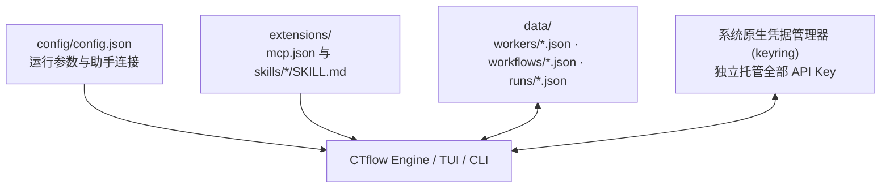

# ADR 0001：纯文件资产存储、外置扩展目录与系统凭据管理

日期：2026-11-19
状态：已采纳

### 背景与目标

CTflow 作为单机多 Worker 依赖图工作台，管理三类不同生命周期与安全等级的数据：高频复用的编排资产（Worker 角色与 Workflow 拓扑）、外部接入生态（MCP 服务器与 `SKILL.md` 技能包），以及敏感的模型上游 API Key。编排资产需要同时支持人工直接审阅编辑、Git 版本管理，以及由内置编排服务者通过标准文件系统工具读写生成；敏感凭据则需要严格的本机安全隔离，避免出现在任何业务配置文件、运行快照或对话上下文中。

### 架构决策

项目采用三区物理分离的目录布局与纯文件持久化机制。全局运行参数保存在 `config/config.json`，配置快照保存在 `config/backups/`。外部扩展能力统一收拢至 `extensions/` 目录，其中 `extensions/mcp.json` 直接采用业界通用的 `mcpServers` 结构登记 `stdio` 与 `http` 工具服务，`extensions/mcp/` 存放本地 MCP 脚本，`extensions/skills/<name>/SKILL.md` 存放可按需挂载的角色技能文档。业务资产与执行记录以独立 UTF-8 JSON 文件保存在 `data/` 下，按 `workers/worker-<id>.json`、`workflows/workflow-<id>.json` 与 `runs/run-<id>.json` 组织，文件名前缀同时规避 Windows 保留设备名冲突。单 Worker 多轮对话保持内存态运行，退出进程即释放。

模型连接采用标准 OpenAI Chat Completions 流式接口，`src/ctflow/secrets.py` 通过 `keyring` 将各 Worker 及编排助手的 API Key 委托给操作系统原生凭据管理器（如 Windows Credential Locker 与 macOS Keychain）保管。所有落盘 JSON 文件与运行日志在序列化阶段自动剔除凭据字段并对文本执行密钥脱敏。

### 影响与权衡

纯文件 JSON 使编排资产对人类编辑器、版本控制与标准文件系统 MCP 完全透明，单机数十个角色与工作流的读写延迟保持在毫秒级。存储层在保存时通过同目录临时文件与原子替换保证单文件写入完整性，并在列表扫描阶段自动跳过损坏文件、记录告警路径，确保单个外部编辑错误不影响其余工作流正常加载。跨设备迁移工作区时，用户可直接复制 `data/` 与 `extensions/` 下的明文配置，并在目标机器重新录入对应 API Key。
