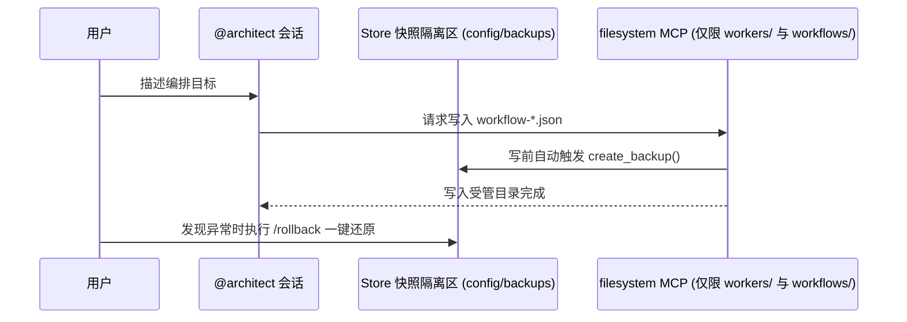

# ADR 0002：独立物理隔离的编排服务者与自动快照回滚机制

日期：2026-11-19
状态：已采纳

### 背景与目标

自然语言生成工作流拓扑与批量调优角色配置是降低多节点编排门槛的核心入口。引入具备文件读写权限的编排服务者（`@architect`）后，系统需要防止该高权限角色误修改自身的系统指令、篡改全局运行配置，或在批量改写配置时破坏现有业务资产。

### 架构决策

系统将 `@architect` 设计为与普通业务 Worker 物理隔离的内置服务者，在 `src/ctflow/architect.py` 中维护。`@architect` 的领域规范、数据契约和简化 Mermaid 拓扑语法作为只读常量固化在源码中，其上游模型连接单独保存在 `config/config.json` 的 `architect` 字段及系统 `keyring` 的独立键名下；`data/workers/` 目录与存储接口明确保留 `architect` 标识符，禁止删除或覆盖。每次发起单聊请求时，系统动态扫描当前可用的 Worker、Workflow、MCP 服务器与外置技能清单，组装成 `<workspace_inventory>` 标签块注入上下文，确保生成的拓扑准确引用已有标识。

在权限边界上，`ArchitectTools` 启动官方 `@modelcontextprotocol/server-filesystem` 子进程时，仅将 `data/workers` 与 `data/workflows` 两个子目录传入受管路径白名单，使 `config/`、`extensions/` 与 `src/` 在操作系统进程参数层面处于不可达状态。同时，系统实施写前自动快照机制：每轮首次触发写文件工具或执行 `/flow apply` 提取 Mermaid 代码块落盘前，`Store.create_backup()` 自动将当前 `workers/` 与 `workflows/` 完整备份至受保护的 `config/backups/` 目录并滚动保留最近 10 份快照。用户随时可通过 TUI 的 `/rollback` 命令或 CLI 的 `ctflow rollback` 子命令秒级还原至最近一份完好配置。

### 影响与权衡

依靠进程挂载路径白名单与源码只读定义实现权限收敛，省去了复杂易错的应用层沙箱拦截逻辑。配合毫秒级目录快照与读取端坏文件隔离，用户既能直接享受一句话批量生成和修改多节点工作流的效率，又拥有确定可靠的一键回退保障。
