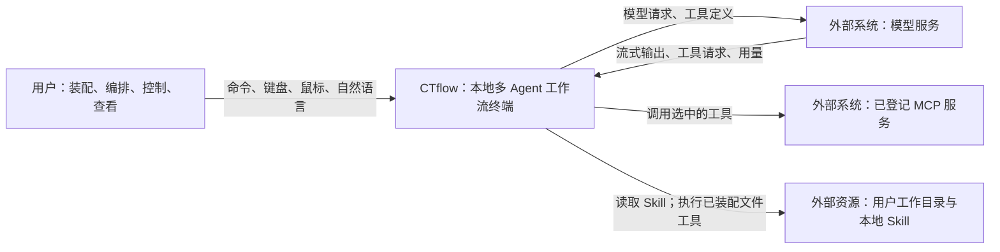
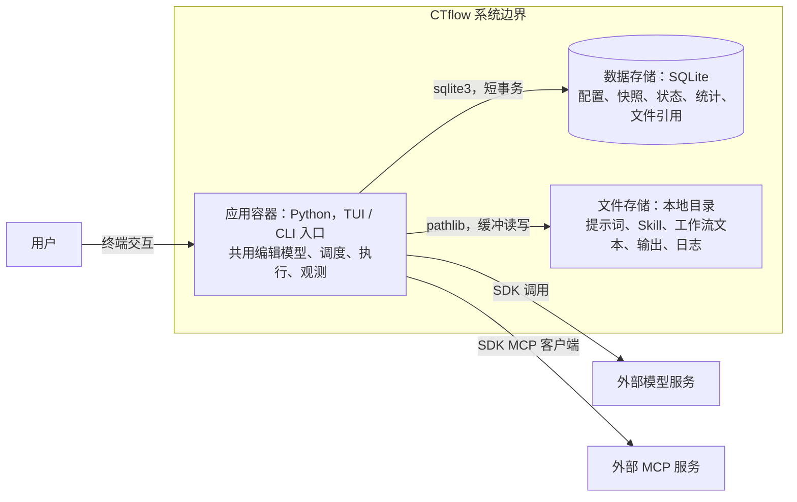
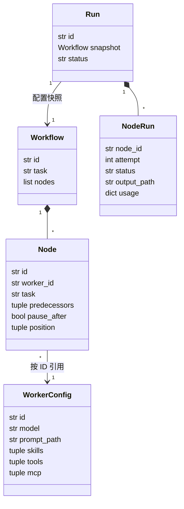
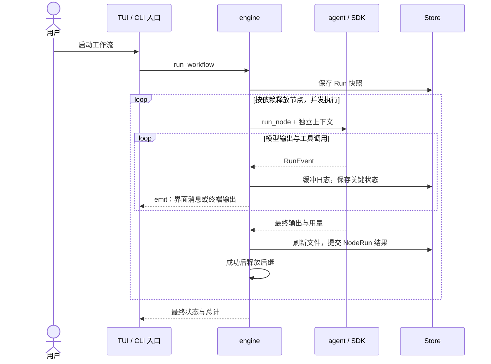

# CTflow C4 架构设计

状态：历史设计草案，保留用于说明取舍。本文描述的目标结构未全部实现；当前交付范围以[实现范围](../实现范围.md)为准。

## 1. 核心取舍

采用本地 Python 应用，提供 TUI 与 CLI 两种入口；每次启动使用单进程、单 `asyncio` 事件循环。业务围绕一份 Workflow、一套节点执行函数和一套运行记录展开。复用以减少独立逻辑和状态来源为标准，代码保持可读、可测试。

| 能力 | 复用方案 |
|---|---|
| 界面、表单、列表、Markdown、后台任务 | Textual 组件及其 Rich 渲染能力 |
| 模型接入、工具循环、流式事件、MCP | Pydantic AI；通过所需 provider 与 MCP extras 安装 |
| DAG 就绪判断与环检测 | 标准库 `graphlib.TopologicalSorter` |
| 并发、暂停、取消 | 标准库 `asyncio` |
| 命令参数与入口分发 | 标准库 `argparse`，集中在 `__main__.py` |
| 数据对象、文件、数据库 | `dataclasses`、`pathlib`、`json`、`sqlite3` |

Pydantic AI 是本草案的 SDK 选型；复用其单 Agent 执行能力。CTflow 自己负责用户编辑的 DAG。SDK 的能力依据其官方[Agent 文档](https://pydantic.dev/docs/ai/core-concepts/agent/)、[模型接入](https://pydantic.dev/docs/ai/models/overview/)与 [MCP 文档](https://pydantic.dev/docs/ai/mcp/client/)。实施时锁定版本并验证事件与取消接口。

## 2. C1：系统上下文



Worker 是可复用配置，Node 是绑定 Worker 的任务实例，Workflow 是执行依赖图。Run 表示一次工作流运行；NodeRun 表示其中一个节点的一次尝试。产品 Worker 与 Textual 的后台任务对象在代码中分别命名为 `WorkerConfig` 和框架原名。

## 3. C2：容器

C4 的容器表示应用或数据存储边界；此处的应用容器是一个 Python 进程。



部署单位是本地应用及数据目录。SQLite 由应用进程访问。TUI 通过 Textual 后台任务承载整个 Run，CLI 通过 `asyncio.run` 承载相同引擎，节点用 `asyncio` task 并发运行；阻塞文件操作交给 `asyncio.to_thread`。普通 CLI 运行时直接输出事件，选择 TUI 模式时才创建 App。

## 4. C3：应用内部组件

```mermaid
flowchart TB
    cli["命令入口：__main__.py\n解析参数、加载 Workflow、终端输出"]
    ui["界面：app.py + canvas.py\n装配台、画布、日志、历史"]
    graph["图操作：graph.py\n解析、导出、校验、默认布局"]
    engine["运行编排：engine.py\n依赖、状态、暂停、取消、重试"]
    agent["节点执行：agent.py\n组装提示词、工具、SDK 事件适配"]
    store["持久化：store.py\n配置、快照、统计、文件读写"]
    sdk["外部库：Pydantic AI\n模型、Agent 循环、MCP"]
    ui -->|统一图编辑入口| graph
    ui -->|启动与控制 Run| engine
    ui -->|装配配置、读取历史| store
    cli -->|按 ID 或唯一名称加载| store
    cli -->|直接运行| engine
    cli -->|选择 TUI 并自动运行| ui
    engine -->|运行一个 Node| agent
    engine -->|保存状态与输出| store
    engine -->|RunEvent 回调| ui
    engine -->|相同 RunEvent，终端输出回调| cli
    agent -->|调用与接收事件| sdk
```

`models.py` 提供共享数据类型，业务模块依赖这些类型。界面引用业务模块，业务模块通过传入的回调输出事件。入口文件组装依赖，组件直接调用具体函数。

| 文件 | 最小职责与主要接口 |
|---|---|
| `__main__.py` | `main` 解析命令、创建依赖，分发至 CLI 或 TUI；CLI 事件输出与退出码映射 |
| `models.py` | `WorkerConfig`、`Node`、`Workflow`、`Run`、`NodeRun`、`RunEvent` 数据对象 |
| `graph.py` | `parse_graph`、`dump_graph`、`validate_graph`、`layout_graph` |
| `agent.py` | `run_node`；内置读写工具、工具登记与 SDK 适配 |
| `engine.py` | `run_workflow`、运行控制对象、统一事件出口 |
| `store.py` | 一个 `Store`，显式 SQL 与内容文件操作 |
| `app.py` | 一个 App，三种主视图、复用表单与日志面板 |
| `canvas.py` | 一个图画布 Widget，绘制、选中、拖动、连线、平移 |

目标是八个 Python 文件，加一份 `app.tcss`。这是初始职责划分；出现独立职责再拆文件。第三方 SDK、标准库与普通函数承担通用能力。

## 5. C4：关键代码结构



这些对象采用 `dataclass`。可变列表使用 `field(default_factory=list)`。运行开始时固定节点、Worker 配置以及提示词、Skill 内容，后续编辑影响下一次运行。SDK 内部消息与工具参数沿用 SDK 类型。

核心调用形状为 `run_workflow(workflow, store, run_node, emit)`；`run_node` 和 `emit` 是传入的可调用对象。引擎接收测试执行函数即可独立验证调度。

## 6. 用同一套代码覆盖产品功能

| 产品入口 | 共用实现 |
|---|---|
| 命令启动已有 Workflow | Store 加载后调用同一引擎；`--tui` 将已选 Workflow 交给 App 自动运行 |
| 独立 Worker 会话 | 包装为单节点 Workflow；后续对话传入本会话消息 |
| 单节点执行 | 仍调用引擎，读取所选 Run 中已成功的直接上游结果；缺失则提示补齐 |
| 人工画布、文本编辑 | 都更新同一份 `Workflow`，共用校验与导出 |
| 自然语言生成 | 通过同一 `run_node` 调用能力运行内置编排配置，产出文本后进入相同解析器 |
| 节点日志、独立会话、历史回看 | 复用相同 Markdown、工具记录、统计与画布组件 |
| Worker / Workflow 克隆 | 复制配置并生成新 ID，使用相同保存函数 |
| Worker 搜索与分组 | 配置字段加列表过滤，共用装配台 |
| 模型、工具和 MCP 装配 | 配置选择 SDK 已支持的能力，使用一个 Agent 创建函数 |
| Token、费用、耗时 | 单节点统计后汇总，顶栏与卡片读取同一份结果 |

Skill 在 P0 中表示选中的本地 `SKILL.md` 指令及其相对资源目录；SDK 工具读取资源。外部 MCP 生命周期由 SDK 上下文管理，本地函数直接注册为工具，网络搜索使用用户选中的搜索工具或 MCP。Worker 配置引用提供方凭据位置，运行快照排除密钥。

图语法限定为 `flowchart TD/LR`、`A["标题 @worker"]`、`A --> B` 和独立节点声明。位置、节点附加任务与暂停点属于 Workflow 元数据，按节点 ID 关联。文本编辑保留仍存在节点的元数据，新增节点使用默认布局。校验覆盖重复 ID、悬空连线、Worker 缺失与环；错误定位到节点或文本行。

### 命令入口契约

```bash
ctflow
ctflow run review
ctflow run review --task "评审当前方案"
ctflow run review --tui
```

安装入口定义为 `ctflow = "ctflow.__main__:main"`，同时支持 `python -m ctflow`。`run` 先按 Workflow ID 精确查找，再按完整名称查找；名称重复时提示改用 ID。加载后共用图校验、配置快照、运行控制和持久化。每次启动新建 Run，`--task` 仅覆盖本次总任务。

CLI 与 TUI 默认使用 `~/.ctflow/` 数据目录，通过全局参数 `--data-dir PATH` 选择其他目录，工作目录变化不影响 Workflow 查找。普通 CLI 将进展、Run ID 和统计写入 stderr，成功终点节点的最终结果按节点 ID 稳定排序写入 stdout；多个结果标注节点 ID。终态刷新输出与存储后退出：成功为 `0`，执行失败或阻塞为 `1`，参数、配置及启动校验错误为 `2`，Ctrl+C 触发共用取消流程并返回 `130`。

人工暂停点通过 `--tui` 操作；普通 CLI 在发起模型或工具调用前检查暂停点并返回 `2`，提示相应启动命令。运行历史可由 TUI 直接打开。命令参数及输出适配收敛在 `__main__.py`，引擎通过同一个 `emit` 回调连接两种入口。

## 7. 调度与运行控制

```mermaid
flowchart LR
    edit["三种编排入口 / 命令加载已有图"] --> graph["Workflow：统一校验"]
    graph --> snapshot["固定配置与运行输入"]
    snapshot --> ready["TopologicalSorter：取就绪节点"]
    ready --> tasks["按并发上限启动 run_node"]
    tasks --> events["状态、文本、工具、用量事件"]
    events --> persist["统一出口：存储与界面更新"]
    tasks --> result{"节点结果"}
    result -->|成功：done| ready
    result -->|失败| blocked["依赖节点阻塞；独立分支继续"]
    ready -->|全部结束或已无可推进节点| finish["完成或带失败结束"]
```

调度使用 `get_ready()` 获取就绪节点，成功后调用 `done()` 释放后继。用 `asyncio.wait(..., FIRST_COMPLETED)` 接收完成结果；某个节点的全部前驱成功即可启动。失败节点保留失败状态，其后继保持阻塞；就绪队列与在途任务都为空时收尾，避免等待无法释放的依赖。图准备的复杂度为 O(V+E)，运行状态空间为 O(V+E+C)，C 为并发任务数。

暂停使用共享 `asyncio.Event` 门：停止启动新节点，已启动模型请求和工具调用完成后，在下一 SDK 执行步等待。`agent.py` 通过 SDK 的逐步执行接口检查门状态。阶段暂停点完成时先关门，再释放后继；已有并行调用收尾后显示暂停。继续打开门。停止则关闭调度、取消在途任务并关闭 SDK 上下文，写入已知状态；已完成的外部工具副作用仍然有效。

失败重试在同一 Run 内增加 `attempt`，复用成功前驱，重建调度视图并继续阻塞的后继；失败尝试的 Token 仍计入总量。整图重跑创建新 Run。成功节点若要改输入重跑，创建新 Run，保证既有输出与输入快照对应。节点上下文仅包含总任务、Worker 指令、本节点任务、本会话历史及直接上游最终文本和证据。

## 8. 一次运行的时序



事件用一个数据对象表达节点、尝试、种类及载荷。`engine.py` 中一个事件出口负责存储与通知当前入口；状态计算由引擎负责。文本增量按节点缓冲，TUI 按固定刷新节奏合并重绘，CLI 通过输出回调显示进展，终态前刷盘，避免逐 Token SQL 与整图刷新。日志属于运行记录；历史通过快照、最终状态和日志直接展示。

## 9. 最小持久化

SQLite 使用四张表：`workers`、`workflows`、`runs`、`node_runs`。配置与配置快照使用 JSON 字段保存；常用列表字段单列索引；节点尝试以 `(run_id, node_id, attempt)` 唯一标识。

SQLite 保存 Workflow 的权威结构与运行状态。纯文件保存提示词、Skill、工作流文本、输出和日志；工作流文本是结构的导出表示，导入经过同一解析器。每项信息的读写入口由 `Store` 管理。新增内容文件写入成功后再提交数据库引用，写入失败使本次保存失败；节点最终输出持久化成功后才标记成功、释放后继。

运行详情使用 `runs/<run_id>/` 下的快照与节点尝试文件。数据库保存它们的引用和统计。完成比例按成功节点数计算；失败、阻塞、停止分别显示。用量使用 SDK 返回值校准，取消时缺失最终用量标记为不完整；费用标明估算，价格缺失时显示待配置。

## 10. 实施验收与方案边界

保留产品文档全部 P0：Worker 装配及独立会话、三种图编辑入口、命令运行已有 Workflow、并行汇合、运行控制、实时拓扑、工具日志、统计与历史。画布鼠标操作和键盘操作共用命令函数；默认布局按拓扑层级排列，连线使用简单正交路径。

实施先验证一条纵向链路：Textual 后台任务运行两个并行节点、一个汇合节点，流式显示事件，暂停后继续，退出后读取历史。随后用产品文档的五 Worker、三阶段演示验收全部 P0。SDK 另需验证并发上下文隔离、工具事件、暂停边界、MCP 清理及取消后的用量口径。

命令验收覆盖按 ID 与唯一名称启动、任务覆盖、`--tui` 自动运行、共享数据目录和历史、stdout / stderr 分流、退出码与 Ctrl+C 清理。对同一 Workflow 和确定性执行替身，CLI 与 TUI 应产生相同的节点输入、依赖行为、输出和统计；分别验证缺失 Workflow、重名及人工暂停点的启动校验。

复用检查关注三件事：同一业务规则是否只有一个实现，同一状态是否只有一个权威来源，多个入口是否确实经过同一执行函数。画布交互是主要自研成本；单 Agent 能力依赖 SDK 对所选模型与工具的支持。本文尚无代码规模与运行性能的实测数据。

## 参考

- [C4 官方视图说明](https://c4model.com/diagrams)：四层视图的范围。
- [Textual Workers](https://textual.textualize.io/guide/workers/) 与 [Messages](https://textual.textualize.io/guide/events/)：后台工作与界面事件。
- [Python graphlib](https://docs.python.org/3.12/library/graphlib.html)：依赖就绪与环检测。
- [Python asyncio](https://docs.python.org/3.12/library/asyncio-task.html)：并发任务与取消。
