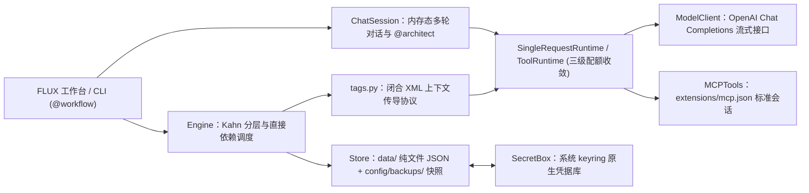

# 实现说明

CTflow 由 Textual 全屏工作台（FLUX）与标准命令行共享同一套异步 DAG 调度引擎、闭合 XML 上下文标签协议、标准 MCP 工具会话以及纯文件持久化层。

### 数据模型与纯文件存储

`Worker` 定义在 `src/ctflow/models.py` 中，包含 `id`、`name`、`model`、`prompt`、`skills`、`base_url`、`api_key`、`extra_body` 与 `mcp_servers`。`Store` 将业务角色、工作流拓扑与运行记录分别保存为 `data/workers/worker-<id>.json`、`data/workflows/workflow-<id>.json` 与 `data/runs/run-<id>.json`，通过同目录临时文件与 `os.replace` 保证原子落盘。所有 API Key 经 `SecretBox` 存入操作系统原生凭据管理器（`keyring`），落盘 JSON 与日志自动剔除凭据并脱敏敏感文本。列表读取在遇到损坏 JSON 时将其路径记入 `corrupted_files` 并跳过，保证其余配置正常可用。

内置编排服务者 `@architect` 在 `src/ctflow/architect.py` 中独立构造，系统规范只读固化在源码内，连接参数保存在 `config/config.json` 的 `architect` 字段中。每次对话动态注入 `<workspace_inventory>` 资产清单，挂载的官方 `server-filesystem` MCP 仅开放 `data/workers` 与 `data/workflows` 两个目录，并在首次执行写类工具或 `/flow apply` 前调用 `Store.create_backup()` 将当前配置备份至 `config/backups/`，支持 `/rollback` 秒级还原。

### 闭合 XML 上下文传导与三级配额收敛

`src/ctflow/tags.py` 为每次模型请求生成边界明确的闭合 XML 标签。System 层按需组合 `<worker_role>`、`<mounted_skills>`（读取 `extensions/skills/<name>/SKILL.md`）与 `<execution_budget>`。工作流节点的 User 层使用 `<workflow_input>` 包裹 `<global_task>`、标注层级的 `<current_node>` 以及 `<upstream_outputs>`；每个 `<upstream>` 子块显式携带直接上游节点的 `id`、`label` 与 `@worker_id` 属性及其最终输出正文。

`src/ctflow/provider.py` 统一通过 `AsyncOpenAI` 发起流式 Chat Completions 请求并拼装增量文本、Token 用量与工具调用参数。节点装配 MCP 服务后，`ToolRuntime` 通过 `asyncio.gather` 并行调用同一轮的多个工具请求，并在仅剩最后 1 轮配额时注入 `<budget_warning>` 提醒；当全部 `max_tool_rounds` 配额耗尽时注入 `<budget_exhausted>` 并以无工具模式执行最后一次收敛总结，确保节点稳定输出完整结论供下游消费。
