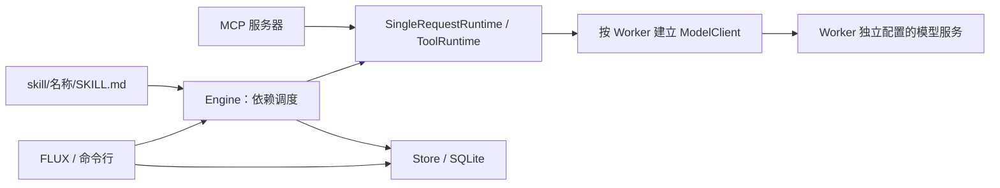

# 最小实现说明

CTflow 的正式入口使用 FLUX 界面。界面和 CLI 共同调用一个 Engine，节点执行经过协议适配 runtime、可选的 MCP 工具会话与供应商客户端，SQLite 保存定义和运行结果。

## 数据和职责

Worker 保存 `id/name/model/prompt/skills/base_url/api_key/extra_body/mcp_servers/protocol`，其中 `protocol` 取 `chat`、`responses` 或 `anthropic`，`prompt` 是固定上下文，`skills` 是项目技能名，`mcp_servers` 引用 `config.json` 中登记的 MCP 服务器。接口地址、密钥、模型、协议和附加请求参数共同构成该 Worker 的独立连接。Node 保存 `id/label/worker_id/task/dependencies`；Workflow 保存名称、总任务和节点图。同一 Worker 可供多个 Node 引用。

创建 Run 时复制工作流和引用的 Worker，并读取所选技能正文存入 `skill_contexts`，后续文件修改不会改变本次运行。内存中的 Worker 副本用于执行；保存 Run 时去除 API Key。各 NodeRun 独立记录状态、输出、错误、用量和起止时间。TUI 直接读取这些对象，正式运行链路使用真实流式结果。Worker 的 API Key 在 Windows 上使用 DPAPI、其他平台使用 Fernet 加密后写入 SQLite；旧版明文在打开数据库时一次性迁移。

## 请求与依赖

每个节点的消息由 Worker 固定上下文、选中技能正文、工作流总任务、节点任务以及直接上游结果组成。在并发限制内，为该节点按 Worker 的连接创建客户端并关闭。不同供应商的节点可并行执行。SDK 的自动重试关闭；没有装配 MCP 时，模型返回工具请求或截断结果会失败。装配 MCP 后，ToolRuntime 会把模型请求的工具交给 MCP 会话执行，再把结果送回模型，最多进行 `max_tool_rounds` 轮。

## MCP 工具

`config.json` 的 `mcp_servers` 登记服务器，支持 `stdio` 和 `http`。Worker 通过 `mcp_servers` 选择服务器；Engine 在创建 Run 时拒绝未登记名称。`mcp_tools.py` 建立 `ClientSession`，读取 `list_tools()`，把工具名规范化为 `mcp_<服务器>_<工具>`，并由 `ModelClient` 按当前协议转换成 Chat Completions、Responses 或 Anthropic 的工具声明。节点日志记录工具开始、完成和失败；工具错误、参数 JSON 错误和超过轮数上限都会使节点失败。

## 协议适配

`provider.py` 为每个 Worker 选择协议。`chat` 调用 OpenAI Chat Completions 流式接口并解析 `tool_calls`；`responses` 调用 OpenAI Responses 流式接口并解析 `function_call`；`anthropic` 使用 `httpx` 调用 Anthropic Messages 接口，解析 `tool_use` 与 `input_json_delta`。三种协议都归一化为同一种 `Reply` 和工具调用结构，`ToolRuntime` 只处理统一结构。自定义 `base_url`、API Key 和 `extra_body` 按 Worker 隔离。

DAG 校验使用 Kahn 算法，时间和空间复杂度为 `O(V + E)`。执行以直接依赖为条件，并以 `asyncio.Semaphore` 限制并发。上游成功后才请求下游模型，失败阻断沿依赖传播，停止取消在途任务及等待任务。Run 的最终状态和各节点结果写回 Store。

当前 runtime 只有两条路径：无工具的单次请求，以及 MCP 工具循环。项目不建立内置文件/搜索工具、插件注册表、会话恢复控制器、暂停/继续或失败重试。

## 界面与技能

`ui.py` 负责命令、模态配置和异步运行任务，`rendering.py` 使用 Rich 绘制图与点击元数据。图中的每张节点卡可以点击装配 Worker；配置窗通过快捷键保存、取消，并提供右上角关闭键。Worker 窗口包含 MCP 服务器字段；其余功能由斜线命令进入。

`tools.py` 负责发现和读取 `workspace/skill/<name>/SKILL.md`。技能名解析到该目录中的文件，正文作为模型输入；文件缺失或编码不合法时报告错误。复制目录后重新打开 Worker 配置即可发现技能。

## 保存和验证

`storage.py` 使用三张 SQLite 表。Worker 表保存完整的本地连接配置，API Key 为平台加密密文；Run 表以及公开 JSON、Mermaid、Markdown 导出排除密钥。数据库是重新加载的依据。工作流编辑保存后可切换和重启加载；另存创建新的 ID。

测试覆盖单请求次数、任意模型 ID 透传、直接上游隔离、并发、失败阻断、停止、技能发现、存储重开、DPAPI 与 Fernet 迁移、三种协议请求格式、MCP stdio 工具、真实 Textual 事件路径上的图点击、配置和多工作流切换。服务调用在自动化测试中替换为可控模型客户端；DeepSeek V4.1 Chat Completions 与 MCP 工具链路单独记录。
