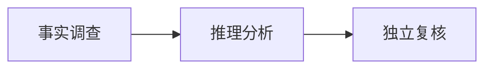
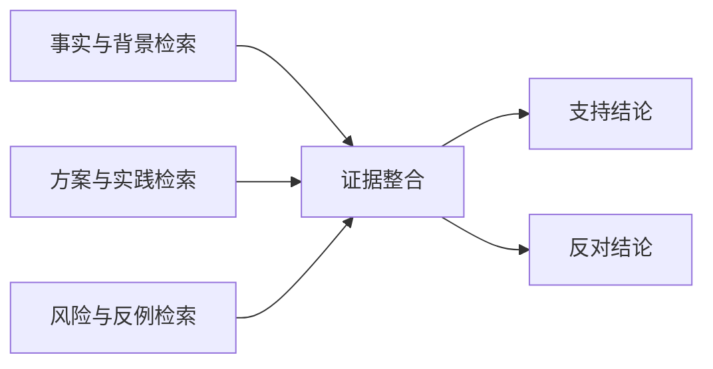
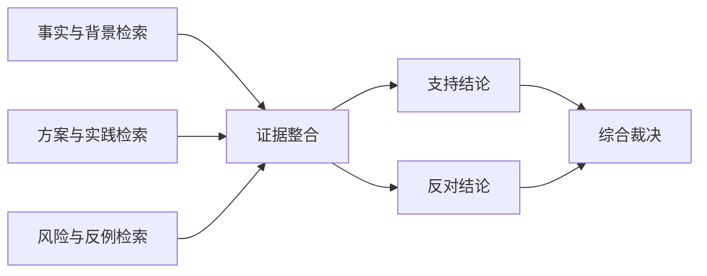

# 工作流示例

在工作台输入 `/flow` 选择已保存的工作流，输入普通文本替换本次研究目标。节点通过 Worker 配置自己的供应商连接，多个分支可以同时使用不同供应商的模型。

也可直接输入 `/flow serial-111`、`/flow debate-312` 或 `/flow decision-3121` 加载对应预设。

## 1 → 1 → 1：调查、分析、复核

这套流程适合一个明确问题。先收集事实，再形成推理链，最后由独立角色检查结论是否得到证据支持。复核节点接收分析节点的结果，分析节点必须带上可追溯的来源和限制。

## 3 → 1 → 2：三方向调查、整合、正反判断

三个检索节点分别关注事实与背景、方案与实践、风险与反例。整合节点等三条支路完成后，整理共同事实、证据冲突与未解决问题。两个结论节点读取同一份整合结果，分别从支持和反对角度展开判断，各自输出结论、成立条件、关键依据和可以推翻判断的证据。

支持与反对是分析视角。证据不足时明确保留判断，证据一致时可以形成相同的最终倾向。`/view result` 分别展示两个终点，`/export` 导出全部节点结果。

## 3 → 1 → 2 → 1：完整研究与裁决

在上一套流程后增加一个裁决节点。它等待正反两方完成，比较论据、检查关键分歧，并给出采纳条件、暂缓条件及下一项验证动作。

## 搜索和模型配置

三个检索 Worker 使用 Qwen 的服务端联网搜索。附加参数包含 `enable_search: true` 与 `search_options.forced_search: true`，仍通过一次 Chat Completions 请求执行。更换供应商时，要在对应 Worker 中调整这些供应商专用参数。[百炼联网搜索说明](https://help.aliyun.com/zh/model-studio/web-search)

当前接口不返回结构化搜索来源；来源说明取自模型正文，应检查网址、日期及其对结论的直接支持。模板要求检索无法完成时明确说明，避免把模型已有知识表述为刚刚检索的事实。

预设共享可复用 Worker。例如改变事实检索 Worker 的模型会影响所有引用它的预设；如需不同配置，可新建 Worker，再在对应节点中装配。已有自定义工作流可以继续保留、切换和另存。
