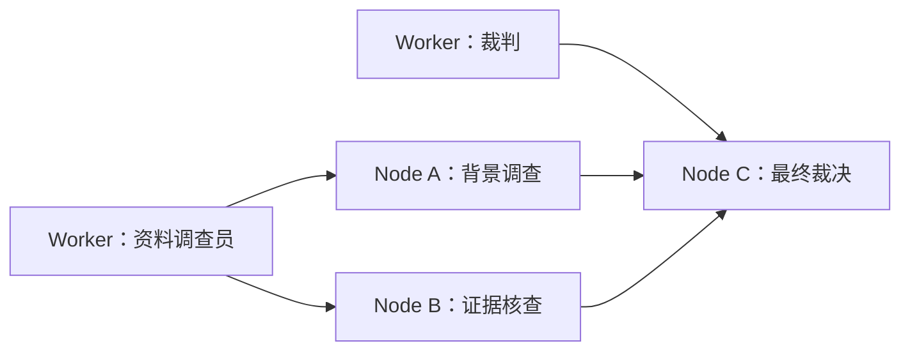
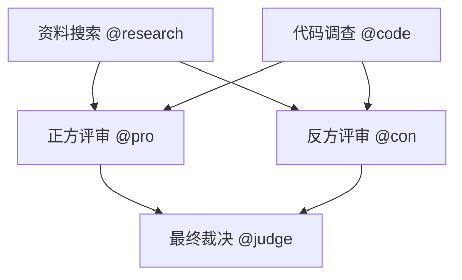
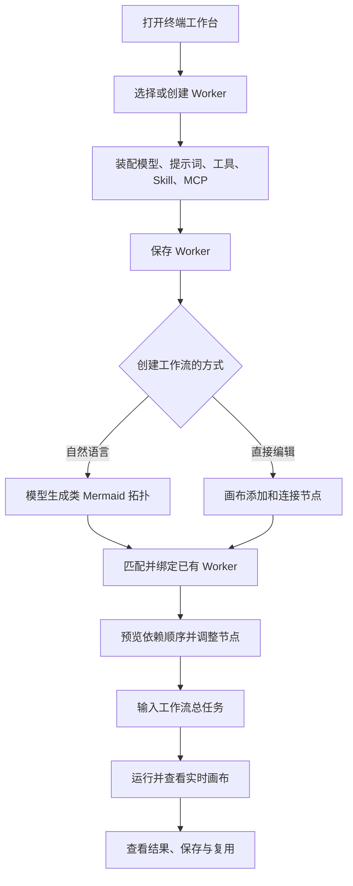
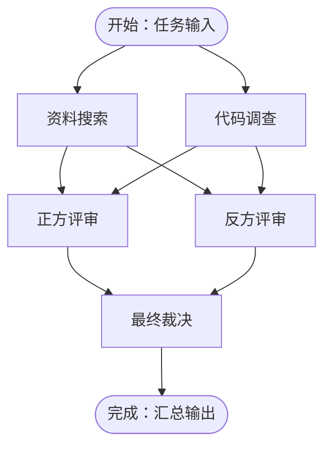
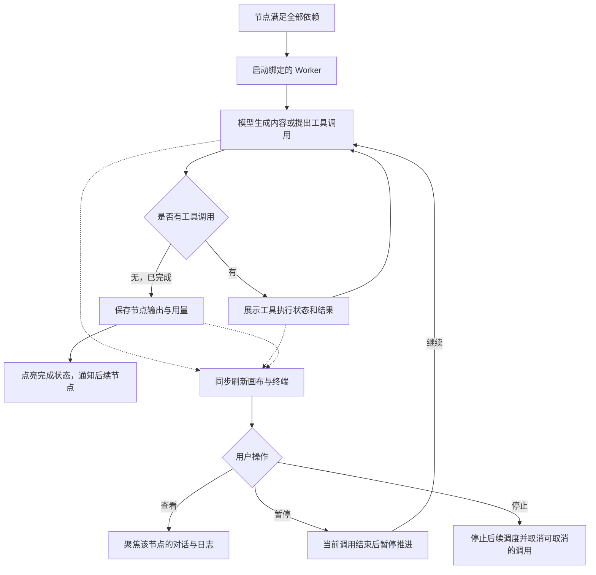

# 多 Agent 工作流可视化终端｜产品文档

> **产品定位**：一个可以自由拼装 Worker、用类 Mermaid 图设计工作顺序，并在终端中实时观察各 Agent 执行过程与 Token 消耗的轻量级产品。
>
> **产品形态**：本地终端应用，提供全屏工作台（TUI）与命令行直接运行（CLI）｜**技术约束**：Python + Textual｜**持久化**：纯文件 JSON + 系统凭据管理（keyring）｜**项目性质**：小组课程设计。

> **当前实现范围（2026-11-19）**：已实现 Worker 独立连接与自定义上游、标准 OpenAI Chat Completions 流式接口、外置 `extensions/` 标准 MCP 与 `SKILL.md` 挂载、三级配额渐进收敛的并行多步工具循环、闭合 XML 标签上下文传导、内置隔离编排服务者 `@architect` 与自动快照 `/rollback`、DAG 顺序/并行/汇合/停止、纯文件存储与 `keyring` 凭据隔离，以及 `ctflow @<workflow>` 跨目录直调与完整 FLUX TUI 工作台。逐项状态以 [实现范围](docs/实现范围.md) 与 [架构决策记录](docs/adr/0001-pure-file-storage-and-keyring.md) 为准。

## 1. 初心与产品方向

### 1.1 为什么要做

现有 Agent 工具已经能够完成搜索、分析和长任务。这个产品关注另一种使用体验：**用户自己拼装执行角色，直接决定协作顺序，并始终看见工作正在如何推进。**

核心目标有四项：

1. **人决定工作顺序**：控制谁先执行、谁并行、谁汇总、在哪个阶段暂停。
2. **Worker 持久化复用**：一个 Worker 装配上游协议、模型、提示词、Skill、MCP 和工具模板后，可以独立使用，也可以挂到任意工作流节点。
3. **执行过程成为可视化内容**：在拓扑图中展示节点状态、当前工具动作、耗时、Token 和费用；点击节点即可查看对应的流式对话与日志。
4. **已有编排一条命令启动**：指定已保存的 Workflow，即可直接运行，并可选择进入实时拓扑工作台。

### 1.2 核心定位

**Dify 的图形化编排 + OpenCode 的终端交互 + Grok Build 的执行反馈与看板，集中在一个以 Worker 为节点单位的轻量级 TUI 中。**

适合代码与文件检索、资料研究、方案评价、多模型交叉评审；尤其适合需要有明确进行顺序的、固定化的工作。如：“第一批调查、第二批并行评审、最后统一裁决”的结构。

### 1.3 设计原则

- **一个节点就是一个完整 Agent**：节点绑定一个已有 Worker 即可运行。
- **图就是工作顺序**：类 Mermaid 文本和终端画布描述同一套节点与依赖关系。
- **先可玩、再扩展**：人工装配 Worker、编排顺序和查看运行状态，优先于复杂的自动优化。
- **交互优先**：动画、进度、工具流、Markdown 展示共同构成产品完成度。
- **配置简单**：单机使用，少量必要字段即可创建 Worker、Node 和 Workflow。

---

## 2. 对标产品与我们的差异化

| 对标产品                                                     | 借鉴能力                             | 本产品的侧重点                                                         |
| -------------------------------------------------------- | -------------------------------- | --------------------------------------------------------------- |
| [Dify Workflow](https://dify.ai/workflows)               | 可视化画布、顺序与并行分支、节点调试、执行追踪          | 节点统一为**可复用的完整 Worker**；在**终端**直接编排与观察多个 Agent                   |
| [OpenCode](https://opencode.ai/docs/agents/)             | 全屏 TUI、专用 Agent、工具调用、Skill 和 MCP | 从单 Agent 会话转为**人工主导的多 Agent 拓扑工作台**                             |
| [Grok Build](https://docs.x.ai/build/modes-and-commands) | 全屏终端、任务计划、子代理、自然语言工作流与运行看板       | 把**可编辑的图**作为工作流主入口，节点直接绑定持久化 Worker，Token / 费用 / 状态**叠加在每个节点上** |

**差异化不在于“第一次实现某项功能”，而在于把以下三个动作连成一个完整、直观的操作体验：**

**装配 Worker → 画出执行顺序 → 在同一张图中观察执行。**

对标取舍：

- 从 Dify 学习拓扑操作和可读性，而不是扩展出大量不同类型的业务节点。
- 从 OpenCode 学习终端的流畅度、Markdown、日志和快捷键。
- 从 Grok Build 学习正在执行的任务如何反馈、暂停和恢复。其官方文档已提供 `/create-workflow` 和 `/workflows`，因此我们的突出特征是**类 Mermaid 图直连 Worker 和图内逐节点观测**。

---

## 3. 核心产品对象

| 对象 | 含义 | 用户管理什么 |
|---|---|---|
| **Worker** | 可长期保存的 Agent 装配方案 | 角色、自定义上游、模型、提示词、外置 Skill、标准 MCP |
| **Node** | 工作流中引用 Worker 的一个任务实例 | 绑定哪个 Worker、节点任务、接收哪些上游结果 |
| **Workflow** | 节点与依赖连线组成的执行图 | 顺序、并行、汇合、暂停点、保存与重跑 |

**基本规则：**

- 同一个 Worker 可以同时出现在多个 Workflow，或者在一个 Workflow 中被多次引用。
- Node 绑定 Worker 后即可使用其现有能力；节点任务提示词为可选补充项，与worker自己提示词叠加生效。
- 每次运行的 Node 都有独立任务上下文。工作流只按连线把上游结果传给下游。
- Agent 是 Worker 在任务中的实际运行表现，用户只需要装配 Worker 和排列 Node。



---

## 4. 核心功能需求

### 4.1 Worker 装配台｜P0

Worker 像角色卡片一样装配，保存后可反复使用。

**Worker 卡片包含：**

| 项目       | 交互要求                                      |
| -------- | ----------------------------------------- |
| worker名称 | 例如“代码调查员”“正方评审员”“最终裁判”“miku”“胡桃”          |
| 默认模型     | 从可用模型列表中选择                                |
| 专属提示词    | 内置编辑区，支持多行文本                              |
| Skills   | 从 `extensions/skills/` 勾选本地 `SKILL.md` 技能 |
| MCP      | 从 `extensions/mcp.json` 已登记的标准 MCP 服务中多选勾选 |
| 独立运行     | 输入任务后直接以该 Worker 开启一次会话                   |
| 管理操作     | 保存、编辑、克隆、删除、搜索、组                          |

**交互亮点**：从 Worker 列表选择一张卡片，拖入画布后自动生成已绑定的 Node。点击 Node 可切换 Worker，并修改当前节点的附加任务提示词。

### 4.2 工作流生成与画布｜P0（当前：表单与 Mermaid 文本编辑；自然语言与拖拽为后续项）

提供三种入口：

1. **人工画布编辑**：添加节点、从 Worker 列表拖入、鼠标移动、连接依赖、删除、保存。
2. **类 Mermaid 文本编辑**：直接输入节点和箭头关系，立即形成可预览的工作流。
3. **自然语言生成**：输入一句任务编排要求，模型输出类 Mermaid 图，自动匹配现有 Worker，得到可运行工作流。

自然语言生成是**核心入口**。模型只负责写出“节点 + Worker 引用 + 连线”，无需生成独立的 Agent 程序或复杂任务代码。

**示例指令：**

> 用资料调查员与代码调查员并行收集证据。全部完成后，让正方和反方评审员并行分析，最后由裁判统一结论。

**生成的类 Mermaid 工作流：**



其中 `@research`、`@code`、`@pro`、`@con`、`@judge` 是已保存的 Worker 标识。图形中的箭头表示执行依赖；缺少匹配 Worker 时，画布直接提示用户选择或创建。

**编辑体验**：鼠标拖动节点、点击端口连线、滚动平移画布；键盘可进行节点选择、移动与连线。保存工作流时一并保存节点位置、绑定与依赖。

### 4.3 工作流执行｜P0

支持的编排模式：

- **顺序**：A 完成后运行 B。
- **并行**：没有相互依赖的 A、B 同时运行。
- **阶段汇合**：C 同时依赖 A、B，则 A、B 均完成才启动 C。
- **统一裁决**：最终节点接收多个上游 Agent 的结论。
- **暂停点**：用户可指定在某一阶段完成后等待继续操作。（后续项，当前最小版未实现）

采用**依赖连线直接表达阶段屏障**，例如上图中正、反方评审都等待资料搜索与代码调查完成，无需另外配置“屏障程序”。

节点执行状态：**等待 → 就绪 → 运行中 → 成功**；运行期间可显示“思考/输出中”“调用工具中”，异常时显示“失败/阻塞”，人工操作可使其“暂停/停止”。

节点默认读取**直接上游节点的最终文本结果**，并结合工作流总任务和自己的节点任务继续执行；结构化证据引用与工具过程详情面板为后续项。MCP 工具的开始、完成和失败会写入节点日志。

**运行操作**：当前实现启动全图、停止和重新运行整个工作流。暂停、继续、单节点运行和失败节点重试为后续项；重试将复用已成功的前置节点结果，下游等待该节点的新结果。

### 4.4 实时可视化｜P0（当前：状态与输出；节点费用明细与工具耗时未实现）

**图中的每张节点卡片直接展示：**

- Worker 名称、模型名称与当前状态。
- 当前动作：正在请求模型、正在执行某个工具、正在输出结果。
- 本节点累计 Token、估算费用与运行耗时。
- 运行完成后的简短结论入口、失败时的错误提示。

**工作流顶部总览：** 已完成节点数/总数、当前阶段、运行时长、总 Token、总费用；线条流动动画强调当前活跃的上下游连接。

**进度口径：** 全图完成比例按已完成节点数量计算。运行中的 Agent 使用真实状态和事件说明进展，不以 Token 使用量伪造任务完成百分比。

**Token / 费用口径：** 显示输入、输出与总 Token；运行中可以显示估算值，调用结束后使用实际返回的用量校准。费用按所选模型价格估算；没有价格信息时显示待配置状态。

### 4.5 Agent 终端｜P0（当前：流式文本与 MCP 工具；独立交互会话未实现）

- **流式 Markdown**：标题、列表、引用、表格、代码块、高亮和可复制文本。
- **工具调用展示**：按发生顺序展示工具名、状态、耗时；点击展开输入参数与返回摘要。
- **节点聚焦**：选择拓扑节点后，下方终端切换至该 Agent 的运行日志、当前输出和结果。
- **独立 Worker 会话**：直接与已装配 Worker 交互，具备同样的工具展示和统计。
- **终端体验**：深色主题、状态颜色、键盘快捷键、斜杠命令、可搜索列表、执行动画。

建议主要命令为 `/worker`、`/workflow`、`/run`、`/model`、`/stats`、`/pause`、`/resume`、`/stop`。

### 4.6 历史与复用｜P0（当前：CLI 历史；TUI 画布回放未实现）

- Worker、Workflow 持久化保存，可修改、克隆和重用。
- 保存每次运行对应的节点配置快照、最终输出、运行时间、Token 与费用记录。
- 历史记录可重新打开画布，查看哪一阶段失败、哪个节点耗费最多 Token。
- `data/workers/`、`data/workflows/` 与 `data/runs/` 以纯文件 JSON 保存角色定义、工作流拓扑与每次运行的完整快照；API Key 独立托管在操作系统原生凭据管理器（`keyring`）中；`@architect` 修改配置前自动向 `config/backups/` 写入快照以供 `/rollback` 回滚。

### 4.7 命令启动已有 Workflow｜P0

提供统一的 `ctflow` 命令，支持以下入口：

```bash
ctflow                                       # 打开 TUI 工作台
ctflow run review                            # 在命令行直接运行已保存的工作流
ctflow run review --task "评审当前方案"        # 为本次运行指定总任务
ctflow run review --tui                       # 打开实时拓扑并立即运行
```

`review` 表示 Workflow ID 或唯一的完整名称。每次命令运行创建新的 Run，读取已保存的节点、Worker 绑定和配置；`--task` 影响本次运行快照。CLI 与 TUI 共用数据目录、执行引擎、运行记录与统计，命令运行结束后可在历史中查看。

普通命令模式将状态、工具进展、Run ID 与统计写入 stderr，将成功终点节点的最终结果写入 stdout。退出码约定为：`0` 全图成功，`1` 执行失败或阻塞，`2` 参数或启动校验错误，`130` 用户通过 Ctrl+C 停止。人工暂停点为后续项，当前 CLI 与 TUI 都只提供运行和停止。

---

## 5. 核心操作流程图

### 5.1 从组装 Worker 到运行工作流



### 5.2 并行、阶段屏障与最终裁决



**执行含义**：A、B 同批并行；二者都完成后，C、D 同批并行；C、D 都完成后，E 开始。

### 5.3 节点运行、反馈与控制



---

## 6. 终端界面与视觉规范

### 6.1 三个主视图

| 视图 | 主要用途 | 核心组件 |
|---|---|---|
| **Workflow 工作台** | 编排与执行观测，默认主页 | Worker 列表、拓扑画布、统计顶栏、节点日志 |
| **Worker 装配台** | 创建、编辑、独立运行 Worker | Worker 卡片、模型选择、提示词、Skill / MCP、测试终端 |
| **Runs 运行历史** | 复盘结果与用量 | 运行列表、图形快照、节点输出、统计对比 |

### 6.2 Workflow 工作台线框

```text
┌──────────────────────────────────────────────────────────────────────────┐
│ AGENT FLOW │ 方案评审                           ● RUNNING │ 3/5 │ $0.09 │
├────────────────┬─────────────────────────────────────────┬───────────────┤
│ WORKERS        │ WORKFLOW GRAPH                          │ INSPECTOR     │
│                │                                         │               │
│ ◉ 资料搜索     │   ┌──────────┐  ┌──────────┐            │ 正方评审      │
│ ◉ 代码调查     │   │✓ 资料搜索│  │✓ 代码调查│            │ worker: pro   │
│ ◉ 正方评审     │   │ 9.8k tok │  │12.4k tok │            │               │
│ ◉ 反方评审     │   └────┬─────┘  └────┬─────┘            │ ● 运行中      │
│ ◉ 最终裁判     │        └──────┬──────┘                  │ 8.3k tokens   │
│                │       ┌───────┴───────┐                 │ $0.036        │
│ [+ Worker]     │   ┌───▼──────┐  ┌─────▼─────┐          │               │
│ [+ Workflow]   │   │● 正方评审│  │● 反方评审 │          │ [查看日志]    │
│                │   │ 8.3k tok │  │ 5.7k tok  │          │ [停止]        │
│                │   └────┬─────┘  └─────┬─────┘          │               │
│                │        └──────┬───────┘                │               │
│                │         ┌─────▼──────┐                 │               │
│                │         │◌ 最终裁决 │                 │               │
│                │         └────────────┘                 │               │
├────────────────┴─────────────────────────────────────────┴───────────────┤
│ NODE TERMINAL · 正方评审                                                 │
│ ✓ 上游结论已就绪  → 已调用 GitHub MCP  → 正在生成分析……                  │
│ >                                                                         │
└──────────────────────────────────────────────────────────────────────────┘
```

终端线框是**交互关系示意**；实际布局随窗口宽度调整。重点保证工作流图始终是视觉中心，选中节点后的日志能快速切换。

### 6.3 状态与交互反馈

- 等待：低亮度节点；运行中：高亮边框和轻量动画；成功：完成标识；失败：错误标识与简短原因。
- 连线体现执行流向；活跃分支使用移动标记或颜色变化，汇合处明确展示仍在等待的前置节点。
- 统计以节点卡片为主，顶部显示总量；右侧详情才展开输入 / 输出 Token、模型与工具记录。
- 快捷键和鼠标操作等价；常用操作优先能在 1～2 步内完成。

---

## 7. 交付优先级与课程展示

### P0｜构成完整产品闭环

1. Worker 装配、保存、克隆、独立运行，支持模型 / 提示词 / 工具模板 / Skill / MCP。
2. 工作流画布，支持节点绑定、拖动、连线、顺序、并行、汇合与保存。
3. 类 Mermaid 文本生成拓扑，自然语言生成并匹配已有 Worker。
4. 执行控制：当前实现运行、停止和重新运行；暂停、继续、失败节点重试与单节点运行为后续项。
5. 图内状态、Token、费用、耗时，选中节点查看流式 Markdown 与工具日志。
6. 纯文件 JSON + 系统 `keyring` 保留角色装配、工作流定义和运行快照，配合隔离快照支持一键回滚。
7. 命令直接启动已保存的 Workflow，支持本次任务输入及实时 TUI 启动。

### P1｜提升完成度

- 工作流模板与克隆、类 Mermaid 文本导入导出。
- 键盘命令面板、主题切换、节点搜索与快速跳转。
- 运行历史中按节点对比 Token、费用与耗时。
- 动画优化、阶段折叠、较大画布的平移与缩放展示。

### 核心验收演示

**场景：多模型方案评审。**

1. 创建并保存“资料搜索”“代码调查”“正方评审”“反方评审”“最终裁判”五个 Worker。
2. 输入自然语言编排要求，生成 5 个 Node、3 个阶段的工作流；预览并手动移动节点。
3. 启动工作流，观察第一阶段两个节点并行；第二阶段等待全部前置节点完成后并行启动。
4. 点击运行中的任意节点，看到该 Agent 的 Markdown 输出、工具调用、Token 与费用变化。
5. 演示五 Worker 三阶段、MCP 工具调用与最终裁决；暂停、继续和失败节点重试列入后续演示。
6. 退出并重新进入终端，打开已保存的 Worker、Workflow 与本次运行历史。
7. 退出工作台，通过 `ctflow run <workflow-id> --task "新的评审任务"` 运行已保存工作流；检查结果、退出码及新增历史，再用 `--tui` 验证拓扑自动启动。

**完成标准：** 用户能够从一个文字指令得到可编辑、可运行的 Agent 工作流，并通过一张实时拓扑图看懂“谁在做什么、为什么还没轮到下一个、花费了多少”。

---

## 8. 技术选型边界

| 项目 | 确定方案 |
|---|---|
| 单一开发语言 | **Python** |
| 终端界面 | **Textual**，使用 Rich / Markdown 展示输出 |
| 数据保存 | **纯文件 JSON + 系统凭据管理（keyring）** |
| 外置扩展 | `extensions/skills/*/SKILL.md` 与 `extensions/mcp.json` 标准 MCP |
| 工作流描述 | 简单的类 Mermaid 节点 / 连线文本 |
| 执行形态 | 本地 TUI / CLI 共用执行引擎，多个 Worker 按图协作 |

技术重点集中在**好用的节点编辑器、可复用 Worker 卡片、低门槛工作流生成、实时可视化**。具体代码组织、引擎内部结构与数据库表设计由开发阶段再确定。

## 9. 参考资料

- Dify Workflow Studio：https://dify.ai/workflows
- OpenCode Agents：https://opencode.ai/docs/agents/
- OpenCode Skills：https://opencode.ai/docs/skills/
- Grok Build Overview：https://docs.x.ai/build/overview
- Grok Build Workflows / Commands：https://docs.x.ai/build/modes-and-commands
- Textual：https://textual.textualize.io/

---

**一句话总结：把长期可复用的 Worker 当成积木，用类 Mermaid 图安排协作，并将整个执行过程与 Token 成本直接显示在终端拓扑上。**
